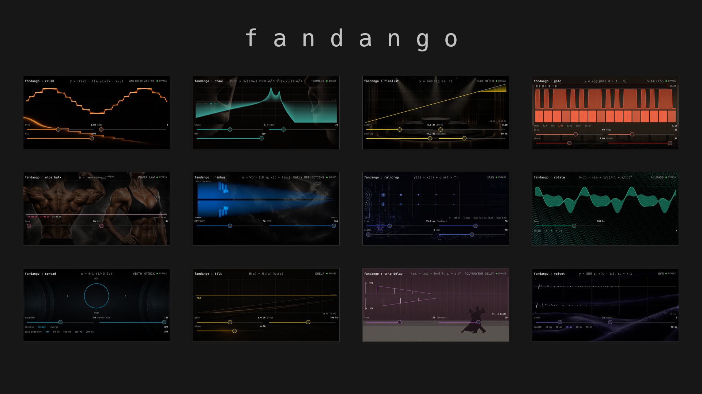

<!-- generated by `cargo run -p fandango-copy --bin copygen -- readme`. Edit copy.toml / copy/*.md, not this file. -->

# fandango by switchworks

> **Closed form. So it never breaks.**<br>**式で閉じる。だから、壊れない。**

Twelve VST3 effects for Windows. Each one is a separate plugin, so you load only what you need.

Built to finish a record in a bedroom. No heavy gear, no setup ritual.

---



---

## Get it / 入手

- [Demo](https://youtu.be/sUw1qtUrsVs) — 125 seconds, no voiceover. Hear it before you
  read anything.
- [Gumroad](https://switchworks.gumroad.com/l/fandango) — the binaries. Name your
  price, $0 minimum. Windows VST3, one zip.
- [GitHub](https://github.com/switchworks/fandango) — source and version tags.
  Under GPL-3, the source matching each released binary is published here.

- [デモ動画](https://youtu.be/sUw1qtUrsVs) — 125 秒、ナレーション無し。
  読む前にまず聴けます
- [Gumroad](https://switchworks.gumroad.com/l/fandango) — バイナリの配布先。
  価格は自分で決める方式で、最低 $0。Windows 版 VST3 を zip 1 つで置いています
- [GitHub](https://github.com/switchworks/fandango) — ソースとバージョンタグ。
  GPL-3 に基づき、配布バイナリに対応するソースをここで公開します

---

## The plugins / 収録プラグイン

**Start with these three.**<br><sub>はじめての 1 本には、この 3 つを。</sub>

- **`:finalist`** — A maximizer you can push without it falling apart. The clearest place to hear where the limit is.<br><sub>押しても壊れないマキシマイザ。効きの限界が一番わかりやすい</sub>
- **`:nice-bulk`** — Two knobs, and only the low and high body comes up.<br><sub>ノブ 2 つで低域と高域の量感だけが増える</sub>
- **`:raindrop`** — Load it and the texture changes outright. A short tail you have heard before.<br><sub>挿すと音の質感がはっきり変わる。聞き覚えのある短さ</sub>

**Everything in the pack**<br><sub>全収録</sub>

| Plugin | Type | |
|---|---|---|
| **`:spread`** | Stereo width<br><sub>ステレオ幅</sub> | It widens. The phase does not move.<br><sub>広げても、位相は動かない。</sub> |
| **`:raindrop`** | Short delay<br><sub>ショートディレイ</sub> | That short tail. You already know it.<br><sub>その短い響きを、知っている。</sub> |
| **`:gate`** | Gate<br><sub>ゲート</sub> | It cuts exactly where you wrote it.<br><sub>書いたとおりに、切れる。</sub> |
| **`:drawl`** | Formant<br><sub>フォルマント</sub> | It never adds gain. The output level follows the material and the vowel.<br><sub>ゲインを足さない設計。出力レベルは素材と母音に従う。</sub> |
| **`:trip-delay`** | Delay<br><sub>ディレイ</sub> | Left drifts off right, and the beat multiplies.<br><sub>左右がずれて、拍が増える。</sub> |
| **`:velvet`** | Mono to stereo<br><sub>モノ → ステレオ</sub> | Width, made out of mono.<br><sub>モノから、幅を作る。</sub> |
| **`:rotate`** | Phase rotation<br><sub>位相回転</sub> | Same tone. Cut the peaks first.<br><sub>音色は変えず、山は先に削る。</sub> |
| **`:crush`** | Bit crusher<br><sub>ビットクラッシャー</sub> | Drop the bits. Nothing smears.<br><sub>落としても、濁らない。</sub> |
| **`:tilt`** | Tilt EQ<br><sub>ティルト EQ</sub> | Bright or dark, one knob.<br><sub>明暗を、1本で。</sub> |
| **`:nice-bulk`** | Low and high body<br><sub>低域・高域の量感</sub> | The further you turn it, the fatter it gets.<br><sub>上げるほど、太くなる。</sub> |
| **`:nimbus`** | Early reflections<br><sub>初期反射</sub> | It doesn't widen. It settles things in.<br><sub>広げるのではなく、馴染ませる。</sub> |
| **`:finalist`** | Maximizer<br><sub>マキシマイザ</sub> | The floor is set at the industry standard.<br><sub>最低ラインを、業界標準に置いた。</sub> |

---

## What this is

None of these plugins listen to your audio and change their behavior.
The shape of the effect is fixed in **closed form**, so there is no
"for this kind of source, apply this correction" decision anywhere inside.

That buys three things.

**1. Zero really is zero.**
At the "no effect" position nothing changes. No slight coloration,
no phase shift. Bypass and output match. Turn the knob back and the
original sound is always there.

**2. The same position always behaves the same way.**
You will still move the knob for different material — that is normal.
What does not happen is a plugin that lurches on one source, or works
in the opposite direction from what you expected. The amount you turn
and the direction the sound moves stay in agreement all the way.

**3. It doesn't break, however far you push it.**
No clipping, no DC, no aliasing — not because the tests came back
clean, but because the formula cannot produce them. Nothing falls
apart at extreme settings, so you can judge from the edge.
One example: `:finalist` never lets a single sample past the ceiling you set.

In exchange, fandango is not the kind of gear that transforms a track
the moment you load it. Nothing here analyzes your source and decides
what it needs. All of that cleverness was spent on not breaking.

## Requirements

- OS: Windows 10 / 11 (64-bit)
- Format: VST3 (64-bit), any VST3-capable DAW
- Sample rate and buffer size follow the host

## Install

Copy the twelve `fandango - *.vst3` folders into the standard VST3 folder:

```
C:\Program Files\Common Files\VST3\
```

Copy the folders themselves, not their contents — each one is a VST3
bundle that the host reads as a single plugin.

Restart the DAW, or rescan plugins.

## License

GPL-3.0-or-later. Free to redistribute. The source matching each
released binary is published under the corresponding version tag.

Full text: [LICENSE](https://github.com/switchworks/fandango/blob/main/LICENSE). Third-party dependency licenses:
[licenses/THIRD-PARTY.md](https://github.com/switchworks/fandango/blob/main/licenses/THIRD-PARTY.md).

## Also included: foobar2000

A side port is in the same download, as a separate zip: five of the twelve — `:spread`, `:crush`, `:tilt`, `:nice-bulk`, `:finalist` — built as foobar2000 DSPs, so you can use them while listening rather than while producing. Same formulas as the VST3 versions. Installation is covered by the `INSTALL-fb2k.txt` inside that zip.

## If you care how it is built

Rust, built on [nih-plug](https://github.com/robbert-vdh/nih-plug). The formula and measured figures for each plugin are in [docs/design.md](docs/design.md); build steps and the licensing history are in [docs/development.md](docs/development.md).

---

Windows 向け VST3 エフェクトプラグイン 12 本の詰め合わせです。1 本ずつ独立した VST3 なので、必要なものだけ挿せます。

ベッドルームで作品を仕上げるために作りました。重い機材も、面倒な設定もいりません。

## これは何

音を解析して勝手に挙動を変える仕組みを、一切持たないエフェクト群です。
効きの形は **閉じた式 (closed-form)** で決め切ってあるので、
「この素材ならこの補正」という判断がプラグインの内部に存在しません。

そのぶん、次の 3 つが成り立ちます。

**1. ゼロは、本当にゼロ。**
「効果なし」の位置で、音は一切変わりません。わずかに色がつくことも、
位相がずれることもありません。バイパスと出力が一致します。
迷ったらツマミを戻せば、必ず元の音に帰ってこられます。

**2. 同じ位置なら、同じ効き方をする。**
素材によってツマミの位置は変わります。変わらないのは効き方のほうで、
「特定の音源でだけ挙動が急変する」「思ったのと逆に効く」は起きません。
ツマミを動かした量と、音の変化の向きが最後まで一致します。

**3. どこまで上げても、壊れない。**
音が割れない・DC が乗らない・折り返しノイズが出ない。
これはテストで確かめた結果ではなく、式の形からそうなっています。
攻めた設定でも破綻しないので、限界まで踏み込んで判断できます。
一例として `:finalist` の出力は、指定した天井を 1 サンプルも超えません。

代わりに、fandango は**初手で劇的に化ける類の装置ではありません**。
音源を解析して勝手に良くしてくれる機能もありません。
その手の賢さは全部、壊れないことのほうに使いました。

## 作りに興味があれば

Rust + [nih-plug](https://github.com/robbert-vdh/nih-plug) で実装しています。各プラグインの数式と実測値は [docs/design.md](docs/design.md)、ビルド手順とライセンスの経緯は [docs/development.md](docs/development.md) にあります。

---

## Disclaimer

Not affiliated with Fandango Media, Inc.
